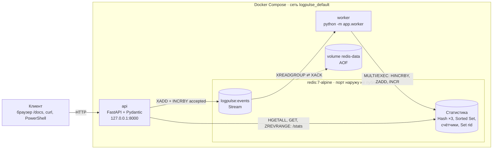

# LogPulse

Небольшой сервис для приёма текстовых логов (сервисы `auth`, `orders`, `payment`), автоматического разбора
событий и построения статистики в Redis. Работает по схеме **API → очередь Redis Streams → worker → статистика в Redis**
и поднимается одной командой через Docker Compose.

## Архитектура



Редактируемая схема: [`architecture.drawio`](architecture.drawio) (открывается на https://app.diagrams.net/),
превью: [`architecture.png`](architecture.png).

Как идёт событие:

1. Клиент отправляет `POST /ingest` со списком строк.
2. API разбирает каждую строку парсером. Валидные превращаются в события и кладутся в Redis Stream
   `logpulse:events` (`XADD`), счётчик `accepted` растёт. Невалидные в очередь **не попадают**, их причины
   возвращаются в поле `errors`.
3. Worker читает стрим через consumer group (`XREADGROUP`), одной транзакцией обновляет статистику
   и только после этого подтверждает сообщение (`XACK`).
4. `GET /stats` и `GET /events` читают данные из Redis. Ничего важного в памяти API не хранится.

## Состав компонентов

| Компонент | Файл | Назначение |
|---|---|---|
| Парсер | `app/parser.py` | основная регулярка с именованными группами + `datetime`, `ipaddress`, проверки диапазонов; 4 дополнительные регулярки (очистка, `rid`, путь, поиск секретов) |
| Работа с Redis | `app/redis_store.py` | ключи, `XADD`, обновление статистики, чтение статистики и последних событий |
| Worker | `app/worker.py` | цикл `XREADGROUP`/`XACK`, дообработка неподтверждённых сообщений, переподключение к Redis |
| Приём логов | `app/service.py` | строки → парсер → очередь (`ingest_lines`) |
| API | `app/main.py`, `app/routes.py` | FastAPI-приложение, `APIRouter` с ручками |
| Модели | `app/schemas.py` | Pydantic-модели запросов и ответов |
| Ошибки | `app/errors.py` | единый формат ошибок и обработчики 422 / 503 / 500 |
| Зависимости | `app/deps.py` | `get_db`: переопределяемая зависимость с клиентом Redis |
| Настройки | `app/config.py` | переменные окружения |
| Утилита | `app/cli.py` | ручная проверка: `load`, `stats`, `reset` |
| Тестовые данные | `data/sample.log` | 51 строка: 44 корректные и 7 ошибочных |

### Структуры Redis

| Ключ | Тип | Команды | Назначение |
|---|---|---|---|
| `logpulse:events` | Stream | `XADD` / `XREADGROUP` / `XACK` | очередь событий (группа `logpulse-workers`) |
| `logpulse:stats:level` | Hash | `HINCRBY` / `HGETALL` | счётчики по уровням |
| `logpulse:stats:service` | Hash | `HINCRBY` / `HGETALL` | счётчики по сервисам |
| `logpulse:stats:status` | Hash | `HINCRBY` / `HGETALL` | счётчики HTTP-статусов |
| `logpulse:slow` | Sorted Set | `ZADD` / `ZREVRANGE` | ТОП медленных запросов: score = `duration_ms` (порог ≥ 500), member = `rid` |
| `logpulse:processed` | Set | `SADD` / `SISMEMBER` | `rid` уже учтённых событий (идемпотентность) |
| `logpulse:stats:accepted` | String | `INCRBY` / `GET` | сколько событий принято в очередь |
| `logpulse:stats:processed` | String | `INCR` / `GET` | сколько событий обработано worker'ом |

Разница между `accepted` и `processed` (поле `backlog` в `/stats`) показывает, сколько событий ещё ждёт обработки.

## Формат строки лога

```
2026-10-20T12:34:56Z INFO auth 192.0.2.10 POST /api/login 200 43ms rid=ab12cd34
```

Допустимо: уровни `INFO` / `WARN` / `ERROR`; сервисы `auth` / `orders` / `payment`; методы `GET` / `POST` / `PUT` / `DELETE`;
корректный IPv4; код ответа 100–599; длительность 0–600000 мс; `rid` из 8 символов `0-9a-f`;
путь начинается с `/` и не содержит `..`. Порог медленного запроса: `duration_ms ≥ 500`.

## Запуск (Docker Compose)

Требуется Docker Desktop (или Docker Engine с Compose v2).

```bash
cp .env.example .env          # необязательно: у всех переменных есть значения по умолчанию
docker compose up --build -d
docker compose ps             # redis и api должны быть healthy, worker running
docker compose logs --tail=50 api worker redis
```

Сервисы:

| Сервис | Что делает | Доступ |
|---|---|---|
| `redis` | Redis 7 с AOF, именованный volume `redis-data`, healthcheck `redis-cli ping` | порт наружу **не публикуется**, внутри сети по имени `redis` |
| `api` | FastAPI на uvicorn, стартует после `redis: service_healthy` | `http://127.0.0.1:8000` (только с этого компьютера) |
| `worker` | `python -m app.worker`, стартует после `redis: service_healthy` | без порта |

Переменные окружения (см. `.env.example`): `REDIS_URL` (в контейнерах `redis://redis:6379/0`), `API_PORT`,
`WORKER_NAME`, `WORKER_BATCH`, `WORKER_BLOCK_MS`.

Остановка: `docker compose down`. Команда `docker compose down -v` **удаляет volume с данными Redis**, используйте её только осознанно.

### Локальный запуск без Docker (для разработки)

```bash
python -m venv .venv
.venv\Scripts\Activate.ps1                 # Windows PowerShell; Linux/macOS: source .venv/bin/activate
pip install -r requirements-dev.txt
docker run -d --name logpulse-redis -p 127.0.0.1:6379:6379 redis:7-alpine
uvicorn app.main:app --reload              # окно 1
python -m app.worker                       # окно 2
```

По умолчанию приложение ходит в `redis://localhost:6379/0`.

## Тестирование

```bash
pytest -q                          # на хосте
docker compose exec api pytest -q  # внутри контейнера
```

Тесты не требуют настоящего Redis: используется `fakeredis`, а в API-тестах зависимость `get_db`
подменяется через `app.dependency_overrides` (рабочие данные не затрагиваются).
Покрыто: парсер и регулярки, `sample.log`, очередь и worker (накопление счётчиков, ТОП медленных,
повторная доставка без дублей статистики, битые сообщения, переподключение), все ручки API
(лимиты, 422, 503, 404/405, единый формат ошибок, сквозной сценарий с `sample.log`).

## API

Swagger UI: **http://127.0.0.1:8000/docs** · схема OpenAPI: http://127.0.0.1:8000/openapi.json

| Метод | Путь | Описание | Коды |
|---|---|---|---|
| GET | `/health` | доступность API и Redis (`PING`) | 200, 503 |
| POST | `/ingest` | приём строк: 1–100 строк, длина каждой 1–500 символов | 200, 422, 503 |
| GET | `/stats` | агрегированная статистика и `top_slow` (ТОП-5) | 200, 503 |
| GET | `/events?limit=10` | последние события стрима, новые первыми, `limit` 1–50 | 200, 422, 503 |

### Примеры (PowerShell)

```powershell
# здоровье
Invoke-RestMethod http://127.0.0.1:8000/health

# приём пакета: 1 корректная + 1 некорректная строка
$body = @{ lines = [string[]]@(
  "2026-10-20T12:34:56Z INFO auth 192.0.2.10 POST /api/login 200 43ms rid=ab12cd34",
  "not a log line") } | ConvertTo-Json
Invoke-RestMethod -Method Post -Uri http://127.0.0.1:8000/ingest `
  -ContentType "application/json; charset=utf-8" -Body $body

# загрузка всего sample.log
[string[]]$lines = Get-Content data\sample.log
$body = @{ lines = $lines } | ConvertTo-Json
Invoke-RestMethod -Method Post -Uri http://127.0.0.1:8000/ingest `
  -ContentType "application/json; charset=utf-8" -Body $body | ConvertTo-Json -Depth 5

# статистика и последние события
Invoke-RestMethod http://127.0.0.1:8000/stats | ConvertTo-Json -Depth 5
Invoke-RestMethod "http://127.0.0.1:8000/events?limit=5" | ConvertTo-Json -Depth 5
```

### Примеры (curl)

```bash
curl -s http://127.0.0.1:8000/health
curl -s -X POST http://127.0.0.1:8000/ingest -H "Content-Type: application/json" \
     -d '{"lines": ["2026-10-20T12:34:56Z INFO auth 192.0.2.10 POST /api/login 200 43ms rid=ab12cd34", "not a log line"]}'
curl -s http://127.0.0.1:8000/stats
```

Ответ `/ingest` для смешанного пакета (1 корректная + 1 некорректная):

```json
{
  "accepted": 1,
  "rejected": 1,
  "errors": [
    {"line_no": 2, "reason": "строка не соответствует формату лога", "line": "not a log line"}
  ]
}
```

Ответ `/stats` после обработки `sample.log` (сокращённо):

```json
{
  "accepted": 44, "processed": 44, "backlog": 0, "pending_unacked": 0,
  "by_level":   {"INFO": 18, "WARN": 13, "ERROR": 13},
  "by_service": {"auth": 16, "orders": 14, "payment": 14},
  "by_status":  {"204": 5, "401": 5, "502": 4, "201": 10, "400": 3, "500": 3, "429": 3, "404": 2, "200": 3, "503": 6},
  "top_slow": [
    {"rid": "b74d0fb1", "duration_ms": 1456},
    {"rid": "71710434", "duration_ms": 1357},
    {"rid": "f4188f3f", "duration_ms": 1250},
    {"rid": "1223b513", "duration_ms": 1244},
    {"rid": "98ae4334", "duration_ms": 1208}
  ]
}
```

### Единый формат ошибок

Все ошибки (кроме `/health`, у которого свой признак состояния) возвращаются в виде:

```json
{"error": {"code": "validation_error", "message": "Некорректная структура запроса",
           "details": [{"field": "body.lines", "message": "List should have at most 100 items after validation, not 101"}]}}
```

| HTTP | `code` | Когда |
|---|---|---|
| 422 | `validation_error` | неверная структура запроса, лимиты `lines` / `limit` |
| 503 | `redis_unavailable` | Redis недоступен (`/health` при этом отвечает `{"status": "degraded", "redis": "down"}`) |
| 404 / 405 | `not_found` / `method_not_allowed` | неизвестный путь / метод |
| 500 | `internal_error` | непредвиденная ошибка: трассировка пишется только в лог сервера |

Значения из запроса в ответ не возвращаются, секреты в сообщениях заменяются на `***`.

## Модели Pydantic (`app/schemas.py`)

| Модель | Поля |
|---|---|
| `IngestRequest` | `lines: List[str]` — 1–100 элементов, длина каждого 1–500 (`Field`) |
| `IngestResponse` | `accepted: int`, `rejected: int`, `errors: List[LineError]` |
| `LineError` | `line_no: int`, `reason: str`, `line: str` |
| `StatsResponse` | `accepted`, `processed`, `backlog`, `pending_unacked`, `by_level`, `by_service`, `by_status` (словари `str → int`), `top_slow: List[TopSlow]` |
| `TopSlow` | `rid: str`, `duration_ms: int` |
| `EventsResponse` | `count: int`, `events: List[EventOut]` |
| `EventOut` | `id`, `timestamp`, `level`, `service`, `ip`, `method`, `path`, `status`, `duration_ms`, `rid` |
| `HealthResponse` | `status: str`, `redis: str` |
| `ErrorResponse` | `error: ErrorBody(code, message, details: List[ErrorDetail] \| None)` |

## Восстановление после перезапуска Redis

Данные Redis лежат в именованном volume `redis-data` и пишутся в журнал AOF, поэтому `docker compose restart redis`
их не теряет. Пока Redis недоступен:

- API отвечает `503` с понятным JSON, `/health` возвращает `degraded`; после возвращения Redis клиент переподключается сам;
- worker не падает: при `ConnectionError` / `TimeoutError` ждёт 1, 2, 4 … 10 секунд и повторяет попытки,
  затем заново вызывает `ensure_group` и дообрабатывает свои неподтверждённые сообщения (`XREADGROUP` с id `0`);
- если Redis поднялся без данных (`NOGROUP`), worker пересоздаёт consumer group.

## Известные ограничения

- **Семантика «минимум один раз».** Если worker упадёт после обновления статистики, но до `XACK`, сообщение придёт повторно.
  От двойного счёта защищает множество `logpulse:processed` (по `rid`), поэтому система опирается на **уникальность `rid`**.
  Проверка и запись делаются не атомарно: при нескольких worker'ах на одном `rid` теоретически возможна гонка.
- **Один worker.** Имя консьюмера (`WORKER_NAME`) фиксированное; масштабирование потребует разных имён и
  стратегии забора чужих зависших сообщений (`XAUTOCLAIM`).
- **Нет dead-letter очереди.** Битое сообщение в стриме логируется и подтверждается, но не сохраняется.
- **Стрим ограничен** примерно 100 000 записей (`MAXLEN ~`): очень старые необработанные события при длительном простое worker'а могут быть вытеснены.
- **`/events`** показывает принятые события из стрима (а не только обработанные); стрим не очищается после обработки.
- **Нет аутентификации и ограничения частоты запросов**, Redis без пароля (доступен только внутри сети Compose).
  Для публичного использования это нужно добавить.
- **Образ содержит тесты и dev-зависимости**, чтобы работало `docker compose exec api pytest -q`; в продакшене их стоит убрать (multi-stage сборка).
- **Нет проверки живости worker'а** в Compose (healthcheck есть только у `redis` и `api`).
- Данные `sample.log` синтетические (адреса из документационных диапазонов), реальных клиентских данных в репозитории нет.

## Структура репозитория

```
app/            исходный код (парсер, Redis, worker, API)
data/           sample.log
tests/          pytest-тесты
Dockerfile  compose.yaml  .env.example  .dockerignore
requirements.txt  requirements-dev.txt  pytest.ini
architecture.drawio  architecture.png
```
